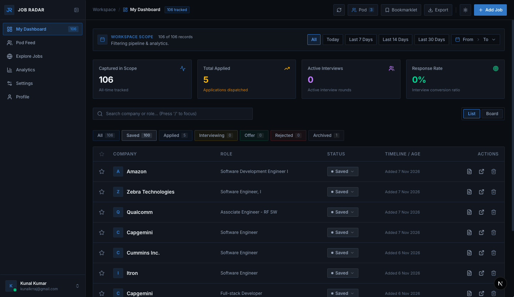
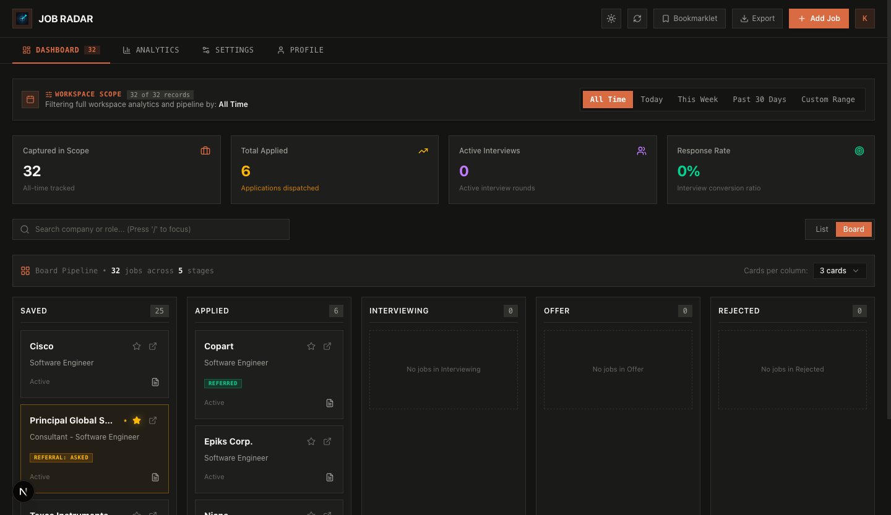
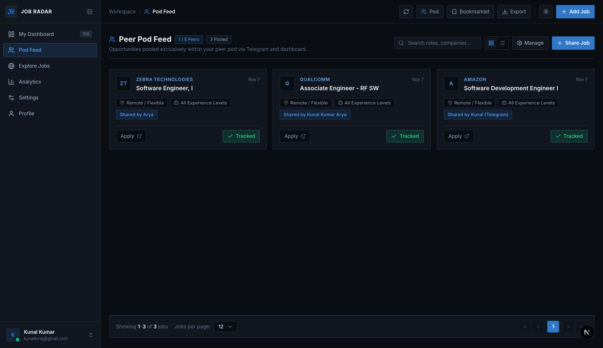
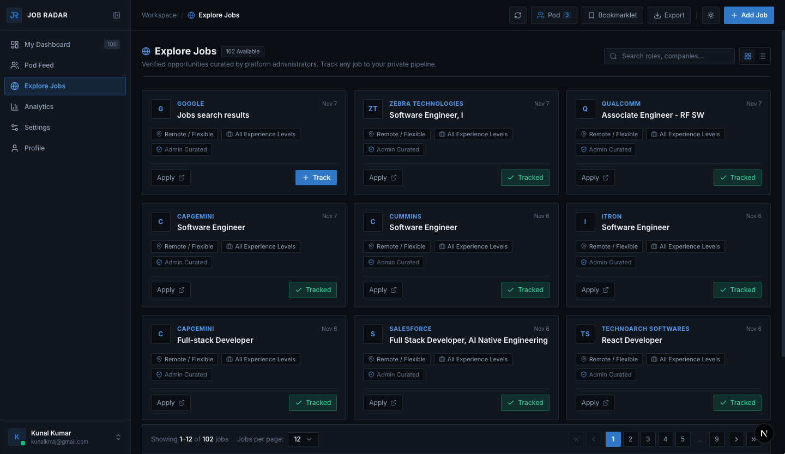
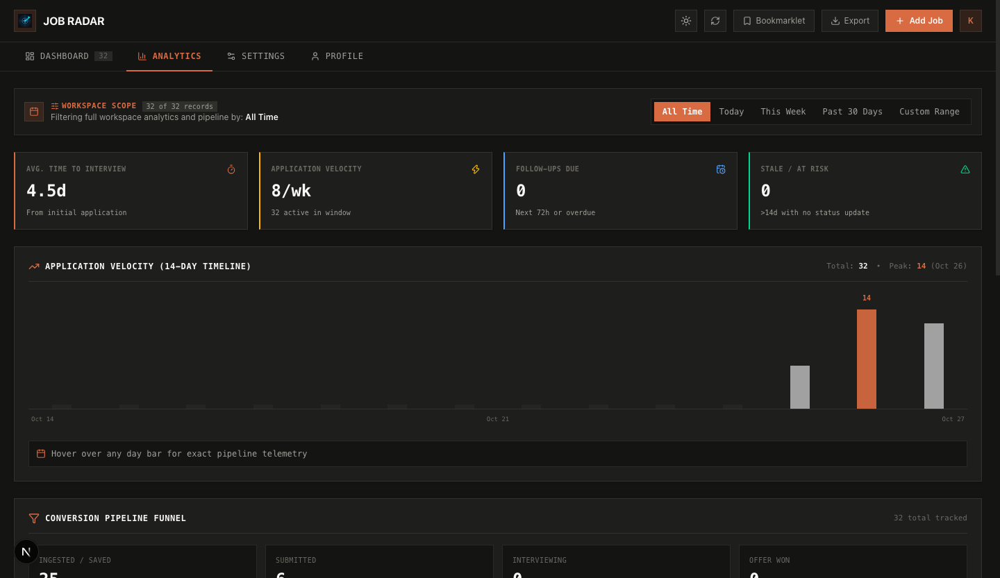
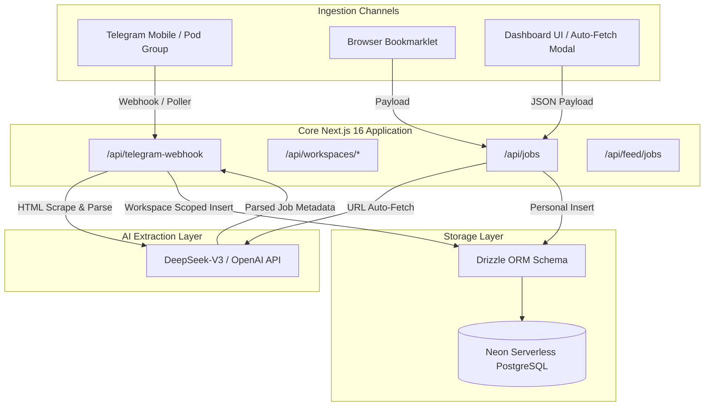

<div align="center">

# Job Radar

### High-Speed Application Pipeline & Career Telemetry Command Center

A private, distraction-free command center for modern software engineers. Ingest job postings instantly from mobile via Telegram, auto-extract job specs using AI, manage referrals, track follow-ups, collaborate with peers in dedicated Job Pods, and visualize velocity across Table and Kanban views.

[](https://nextjs.org/)
[](https://react.dev/)
[](https://www.typescriptlang.org/)
[](https://orm.drizzle.team/)
[](https://neon.tech/)
[](https://tailwindcss.com/)

[Visual Walkthrough](#visual-walkthrough) • [Key Features](#key-features) • [Technical Architecture](#technical-architecture) • [Getting Started](#getting-started) • [Environment Setup](#environment-variables)

</div>

---

## Visual Walkthrough

### 1. Minimalist Landing Page

Anthropic-inspired dark mode landing page featuring interactive live specimens, architectural pillars, comparison matrices, and FAQ accordions.
<div align="center">
  
</div>

---

### 2. High-Density Pipeline Dashboard (Table View)

Fast, keyboard-friendly workspace with company avatars, referral status tags, custom status dropdowns, stale indicators, and one-click actions.
<div align="center">
  
</div>

---

### 3. Kanban Board View with Modular Column Pagination

Columnar pipeline across all hiring stages (`Saved`, `Applied`, `Interviewing`, `Offer`, `Rejected`) with customizable cards per column, star importance toggles, and direct note triggers.
<div align="center">
  
</div>

---

### 4. Dedicated Peer Job Pod Feed

Pool job opportunities with up to 6 peers straight from shared Telegram groups. Features docked bottom pagination and isolated opportunity tracking.
<div align="center">
  
</div>

---

### 5. Peer Pod Collaboration & Telegram Sync

Invite peers via unique invitation links (`/join?code=...`), connect private Telegram groups, test bot connectivity, and manage pod membership.
<div align="center">
  
</div>

---

### 6. Curated Explore Feed

Separate verified public opportunity feed with admin curation, 1-click pipeline import, search filtering, and responsive grid/list switcher.
<div align="center">
  
</div>

---

### 7. Application Details & Referral Tracker Drawer

Slide-out drawer containing follow-up calendar reminder presets (`+3d`, `+1w`), complete referral tracking (referral status, referrer name, contact, notes), and markdown scratchpad.
<div align="center">
  
</div>

---

### 8. Application Velocity & Conversion Analytics

14-day interactive timeline bar charts, application throughput counters, and multi-stage conversion funnel telemetry.
<div align="center">
  
</div>

---

## Key Features

- **Peer Job Pods (Collaborative Pooling)**:
  - Create or join peer pods (up to 6 members) with secure invite codes (`/join?code=...`).
  - Connect a shared Telegram group: any job link posted by members is scraped and added to the shared Pod Feed.
  - Strict separation: Pod opportunities remain within the pod and never pollute the public feed.
  - 1-click tracking: Members can import any pod listing directly into their private pipeline.

- **Public Job Feed & 1-Click Tracking**:
  - **Explore Feed**: Curated public listings posted by administrators.
  - **Grid & List Switcher**: Seamless toggle between responsive cards and table view.
  - **Docked Bottom Pagination**: Anchored pagination bar ensures consistent viewport layout.

- **Multi-Channel Job Ingestion**:
  - **Telegram Bot Webhook**: Post raw job URLs to auto-extract company, role, location, and metadata via AI.
  - **Browser Bookmarklet**: Drag-and-drop bookmarklet to capture career pages directly from browser tabs.
  - **Auto-Fetch Modal**: Scrape role details on-demand with DeepSeek or OpenAI.
  - **Manual Fast Entry**: Keyboard-friendly dialog for manual submissions.

- **Complete Referral Tracking**:
  - Explicit pipeline tracking across 4 states: `No Referral`, `Asked`, `Got Referral`, `Declined`.
  - Store referrer contact information (LinkedIn, email, phone) and internal notes.
  - Color-coded referral tags in Table and Kanban cards.

- **Smart Sync & Performance**:
  - **Zero Network Spam**: Server-side ETag computation returns HTTP `304 Not Modified` when unchanged.
  - **Visibility-Aware Polling**: Sync timers pause when tabs are backgrounded.
  - **Instant Window-Focus Revalidation**: Immediate background refresh on refocus.

- **Data Sovereignty & Security**:
  - Whitelist-enforced authentication with signed 30-day JWT sessions in `HttpOnly` cookies.
  - Instant 1-click CSV export of your entire pipeline history.
  - Serverless PostgreSQL (Neon) with migrations managed via Drizzle Kit.

---

## Technical Architecture



---

## Tech Stack

| Layer              | Technology                                                                                           |
| ------------------ | ---------------------------------------------------------------------------------------------------- |
| **Framework**      | [Next.js 16.4](https://nextjs.org/) (App Router, Turbopack)                                          |
| **Language**       | [TypeScript 5](https://www.typescriptlang.org/)                                                      |
| **UI Library**     | [React 19](https://react.dev/)                                                                       |
| **Styling**        | [TailwindCSS 4](https://tailwindcss.com/) + Design Tokens                                            |
| **Icons**          | [Lucide React](https://lucide.dev/)                                                                  |
| **Database**       | [Neon Serverless PostgreSQL](https://neon.tech/)                                                     |
| **ORM**            | [Drizzle ORM](https://orm.drizzle.team/) & [Drizzle Kit](https://orm.drizzle.team/kit-docs/overview) |
| **Authentication** | [Jose](https://github.com/panva/jose) (JWT) + Google OAuth                                           |
| **AI Layer**       | DeepSeek-V3 / OpenAI GPT-4o-mini                                                                     |

---

## Getting Started

### 1. Clone the repository

```bash
git clone https://github.com/kunalkmaurya/job-radar.git
cd job-radar
```

### 2. Install dependencies

```bash
npm install
```

### 3. Configure environment variables

```bash
cp .env.example .env
```

### 4. Push database schema to Neon

```bash
npx drizzle-kit push
```

### 5. Run the development server

```bash
npm run dev
```

Open [http://localhost:3000](http://localhost:3000) in your browser.

---

## Dashboard Shortcuts

| Key                   | Action                              |
| --------------------- | ----------------------------------- |
| `/`                   | Focus search bar                    |
| `Esc`                 | Close notes drawer / dismiss modals |
| `Click on Card / Row` | Open job details & referral drawer  |
| `Star`                | Toggle priority job status          |
