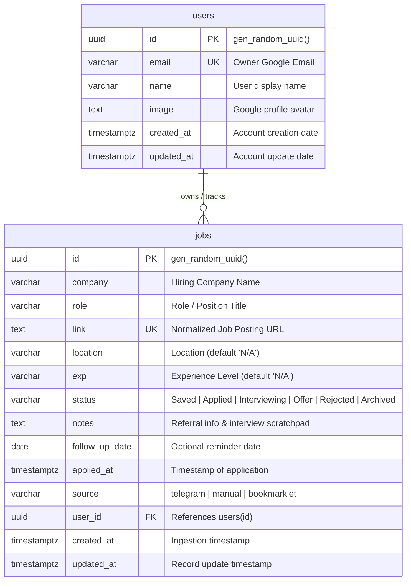

# Database Design Document: Personal Job Search & Tracking Board

## 1. Overview & Architectural Principles

The database layer is hosted on **Neon Serverless PostgreSQL** and interfaced via **Drizzle ORM** (`@neondatabase/serverless`).

### Core Design Principles:

1. **Zero-Overhead Serverless Pooling**: Optimized for serverless Next.js edge and node runtimes over HTTP/WebSockets with zero cold-start delay.
2. **Idempotency & Duplicate Protection**: Enforced via strict unique constraints on the normalized job link URL (`link`).
3. **High-Speed Filter Indexing**: Targeted B-tree indexes supporting sub-millisecond timeline filtering, status aggregations, and stale application checks.
4. **Future-Proof Extensibility**: Columns such as `location` and `exp` are provisioned with default `'N/A'`, allowing future AI extraction without schema alterations or data migrations.

---

## 2. Entity-Relationship Diagram (ERD)



---

## 3. Data Dictionary

### 3.1 `users` Table

Stores the single-user owner account authenticated via Google OAuth.

| Column       | Type           | Constraints        | Default             | Description                      | Example                                 |
| ------------ | -------------- | ------------------ | ------------------- | -------------------------------- | --------------------------------------- |
| `id`         | `UUID`         | `PRIMARY KEY`      | `gen_random_uuid()` | Unique user identifier           | `550e8400-e29b-41d4-a716-446655440000`  |
| `email`      | `VARCHAR(255)` | `UNIQUE, NOT NULL` | _None_              | Google account email             | `kunal@example.com`                     |
| `name`       | `VARCHAR(255)` | `NULLABLE`         | _None_              | Display name from Google profile | `Kunal Kumar`                           |
| `image`      | `TEXT`         | `NULLABLE`         | _None_              | URL to Google profile avatar     | `https://lh3.googleusercontent.com/...` |
| `created_at` | `TIMESTAMPTZ`  | `NOT NULL`         | `CURRENT_TIMESTAMP` | Initial sign-in timestamp        | `2026-10-24 15:30:00+00`                |
| `updated_at` | `TIMESTAMPTZ`  | `NOT NULL`         | `CURRENT_TIMESTAMP` | Profile update timestamp         | `2026-10-24 15:30:00+00`                |

---

### 3.2 `jobs` Table

Core application entity storing all job records and tracking metadata.

| Column           | Type           | Constraints        | Default             | Description                                            | Example                                              |
| ---------------- | -------------- | ------------------ | ------------------- | ------------------------------------------------------ | ---------------------------------------------------- |
| `id`             | `UUID`         | `PRIMARY KEY`      | `gen_random_uuid()` | Unique job record ID                                   | `c3a4f6d8-912b-4832-8431-7b02c81523a1`               |
| `company`        | `VARCHAR(255)` | `NOT NULL`         | _None_              | Company extracted by AI / entered manually             | `Stripe`                                             |
| `role`           | `VARCHAR(255)` | `NOT NULL`         | _None_              | Role title extracted by AI / entered manually          | `Staff Infrastructure Engineer`                      |
| `link`           | `TEXT`         | `UNIQUE, NOT NULL` | _None_              | Job application URL                                    | `https://stripe.com/jobs/12345`                      |
| `location`       | `VARCHAR(255)` | `NOT NULL`         | `'N/A'`             | Job location (reserved for future extraction)          | `'Remote'` or `'N/A'`                                |
| `exp`            | `VARCHAR(100)` | `NOT NULL`         | `'N/A'`             | Experience level (reserved for future extraction)      | `'Senior'` or `'N/A'`                                |
| `status`         | `VARCHAR(50)`  | `NOT NULL`         | `'Saved'`           | Current pipeline stage                                 | `'Saved'`, `'Applied'`, `'Interviewing'`             |
| `notes`          | `TEXT`         | `NOT NULL`         | `''`                | Personal notes, referral contact, interview scratchpad | `Referral by Sarah; round 1 phone screen on Tuesday` |
| `follow_up_date` | `DATE`         | `NULLABLE`         | `NULL`              | Optional calendar follow-up reminder                   | `2026-11-02`                                         |
| `applied_at`     | `TIMESTAMPTZ`  | `NULLABLE`         | `NULL`              | Exact timestamp when marked as 'Applied'               | `2026-10-25 10:15:00+00`                             |
| `source`         | `VARCHAR(50)`  | `NOT NULL`         | `'telegram'`        | Ingestion origin (`telegram`, `manual`, `bookmarklet`) | `'telegram'`                                         |
| `user_id`        | `UUID`         | `NULLABLE, FK`     | `NULL`              | Foreign key referencing `users(id)`                    | `550e8400-e29b-41d4-a716-446655440000`               |
| `created_at`     | `TIMESTAMPTZ`  | `NOT NULL`         | `CURRENT_TIMESTAMP` | Initial ingestion timestamp                            | `2026-10-24 15:35:00+00`                             |
| `updated_at`     | `TIMESTAMPTZ`  | `NOT NULL`         | `CURRENT_TIMESTAMP` | Last updated timestamp                                 | `2026-10-24 15:35:00+00`                             |

---

## 4. Constraints, Enums & Validation

### 4.1 Allowed Status Values

The `status` column is governed by application-level validation (and an optional SQL check constraint):

```sql
ALTER TABLE jobs ADD CONSTRAINT check_job_status
CHECK (status IN ('Saved', 'Applied', 'Interviewing', 'Offer', 'Rejected', 'Archived'));
```

### 4.2 Allowed Ingestion Sources

```sql
ALTER TABLE jobs ADD CONSTRAINT check_job_source
CHECK (source IN ('telegram', 'manual', 'bookmarklet'));
```

---

## 5. Indexes & Query Optimization

```sql
-- 1. Fast Unique URL Lookup for Instant Telegram De-duplication
CREATE UNIQUE INDEX idx_jobs_link ON jobs(link);

-- 2. Pipeline Views & Status Filtering (Board & List views)
CREATE INDEX idx_jobs_status ON jobs(status);

-- 3. Timeline Sorting (Chronological Ordering)
CREATE INDEX idx_jobs_created_at ON jobs(created_at DESC);

-- 4. Funnel Analytics & Stale Application Detection (> 14 days in Applied)
CREATE INDEX idx_jobs_applied_at ON jobs(applied_at DESC) WHERE applied_at IS NOT NULL;

-- 5. User Ownership Index
CREATE INDEX idx_jobs_user_id ON jobs(user_id);

-- 6. Case-Insensitive Search on Company & Role (Trigram / Lower Prefix)
CREATE INDEX idx_jobs_company_lower ON jobs(LOWER(company));
CREATE INDEX idx_jobs_role_lower ON jobs(LOWER(role));
```

---

## 6. Drizzle ORM Schema Implementation

File: `src/db/schema.ts`

```typescript
import {
  pgTable,
  uuid,
  varchar,
  text,
  timestamp,
  date,
  uniqueIndex,
  index,
} from 'drizzle-orm/pg-core';
import { relations } from 'drizzle-orm';

// Users Table
export const users = pgTable(
  'users',
  {
    id: uuid('id').defaultRandom().primaryKey(),
    email: varchar('email', { length: 255 }).notNull().unique(),
    name: varchar('name', { length: 255 }),
    image: text('image'),
    createdAt: timestamp('created_at', { withTimezone: true }).defaultNow().notNull(),
    updatedAt: timestamp('updated_at', { withTimezone: true }).defaultNow().notNull(),
  },
  (table) => [uniqueIndex('idx_users_email').on(table.email)]
);

// Jobs Table
export const jobs = pgTable(
  'jobs',
  {
    id: uuid('id').defaultRandom().primaryKey(),
    company: varchar('company', { length: 255 }).notNull(),
    role: varchar('role', { length: 255 }).notNull(),
    link: text('link').notNull(),
    location: varchar('location', { length: 255 }).default('N/A').notNull(),
    exp: varchar('exp', { length: 100 }).default('N/A').notNull(),
    status: varchar('status', { length: 50 }).default('Saved').notNull(),
    notes: text('notes').default('').notNull(),
    followUpDate: date('follow_up_date'),
    appliedAt: timestamp('applied_at', { withTimezone: true }),
    source: varchar('source', { length: 50 }).default('telegram').notNull(),
    userId: uuid('user_id').references(() => users.id, { onDelete: 'set null' }),
    createdAt: timestamp('created_at', { withTimezone: true }).defaultNow().notNull(),
    updatedAt: timestamp('updated_at', { withTimezone: true }).defaultNow().notNull(),
  },
  (table) => [
    uniqueIndex('idx_jobs_link').on(table.link),
    index('idx_jobs_status').on(table.status),
    index('idx_jobs_created_at').on(table.createdAt),
    index('idx_jobs_applied_at').on(table.appliedAt),
    index('idx_jobs_user_id').on(table.userId),
  ]
);

// Relationships
export const usersRelations = relations(users, ({ many }) => ({
  jobs: many(jobs),
}));

export const jobsRelations = relations(jobs, ({ one }) => ({
  user: one(users, {
    fields: [jobs.userId],
    references: [users.id],
  }),
}));

// Export Types for TypeScript Safety
export type Job = typeof jobs.$inferSelect;
export type NewJob = typeof jobs.$inferInsert;
export type User = typeof users.$inferSelect;
export type NewUser = typeof users.$inferInsert;
```

---

## 7. Critical Application Queries

### 7.1 Telegram Silent Ingestion (Idempotent Upsert / Ignore)

Prevents errors if the user posts the same link twice:

```sql
INSERT INTO jobs (company, role, link, source)
VALUES ($1, $2, $3, 'telegram')
ON CONFLICT (link) DO NOTHING
RETURNING id;
```

### 7.2 1-Click "Apply & Advance" Mutation

```sql
UPDATE jobs
SET
    status = 'Applied',
    applied_at = CURRENT_TIMESTAMP,
    updated_at = CURRENT_TIMESTAMP
WHERE id = $1;
```

### 7.3 Timeline Filtering Query

```sql
-- Today
SELECT * FROM jobs
WHERE created_at >= CURRENT_DATE
ORDER BY created_at DESC;

-- This Week
SELECT * FROM jobs
WHERE created_at >= NOW() - INTERVAL '7 days'
ORDER BY created_at DESC;

-- Last 30 Days
SELECT * FROM jobs
WHERE created_at >= NOW() - INTERVAL '30 days'
ORDER BY created_at DESC;
```

### 7.4 Stale Application Detection (> 14 days in 'Applied')

```sql
SELECT id, company, role, applied_at,
       EXTRACT(DAY FROM (NOW() - applied_at)) AS days_since_applied
FROM jobs
WHERE status = 'Applied'
  AND applied_at < NOW() - INTERVAL '14 days'
ORDER BY applied_at ASC;
```

### 7.5 Funnel Analytics Aggregation (Single-Query Ribbon)

Calculates all header stats in a single database round-trip:

```sql
SELECT
    COUNT(*) AS total_jobs,
    COUNT(*) FILTER (WHERE applied_at >= NOW() - INTERVAL '7 days') AS applied_this_week,
    COUNT(*) FILTER (WHERE status = 'Interviewing') AS interviewing_count,
    COUNT(*) FILTER (WHERE status = 'Offer') AS offer_count,
    ROUND(
        (COUNT(*) FILTER (WHERE status IN ('Interviewing', 'Offer'))::numeric /
         NULLIF(COUNT(*) FILTER (WHERE status IN ('Applied', 'Interviewing', 'Offer', 'Rejected')), 0) * 100),
        1
    ) AS response_rate_percentage
FROM jobs;
```

---

## 8. Migration & Deployment Strategy

- **CLI Tooling**: `drizzle-kit` handles schema versioning.
- **Commands**:
  - `npx drizzle-kit generate`: Creates SQL migration files in `drizzle/` directory.
  - `npx drizzle-kit push`: Instantly applies schema changes directly to Neon PostgreSQL during development.
  - `npx drizzle-kit migrate`: Executes tracked production migrations in CI/CD pipeline.
- **Neon Branching**: Database migrations can be tested on isolated Neon branch databases (`preview` branch) before merging to `main`.
