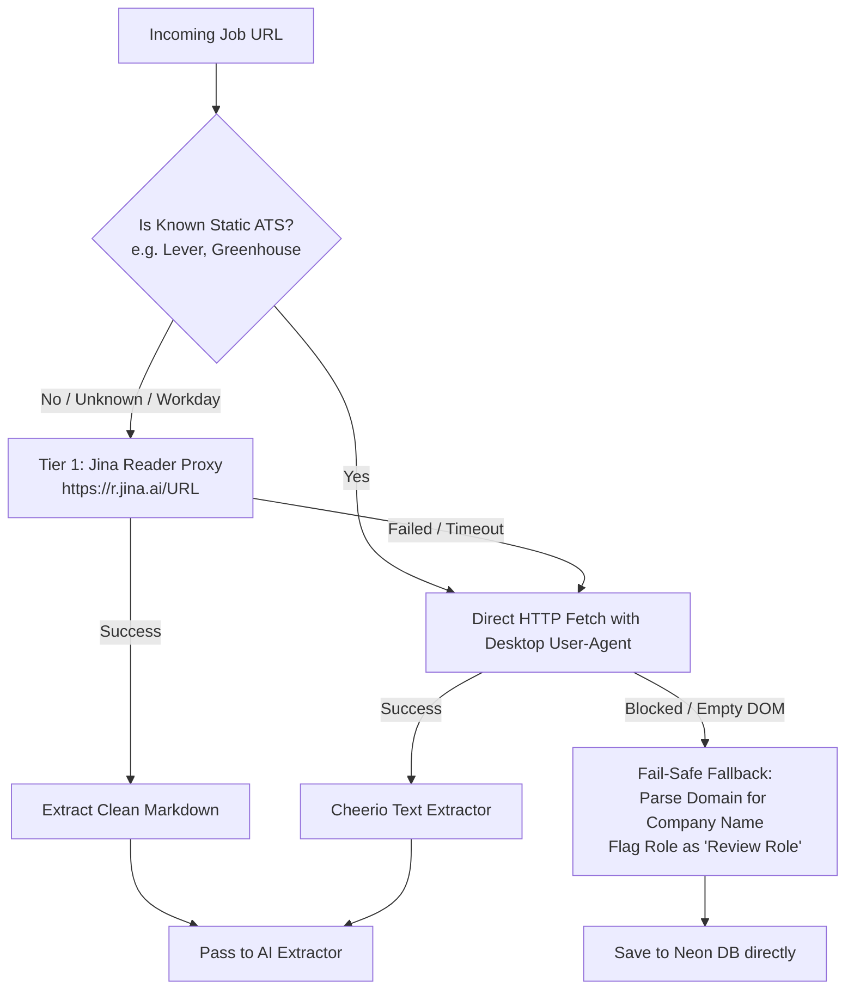
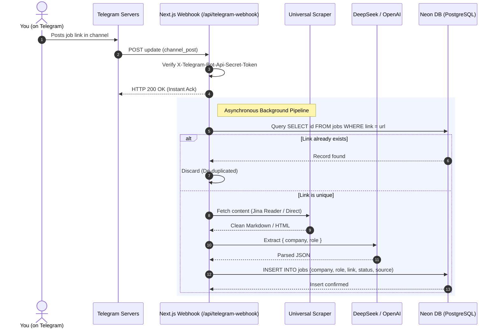
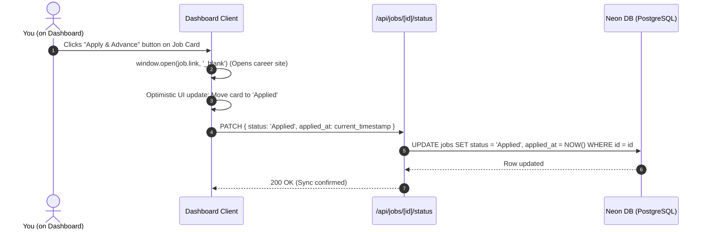
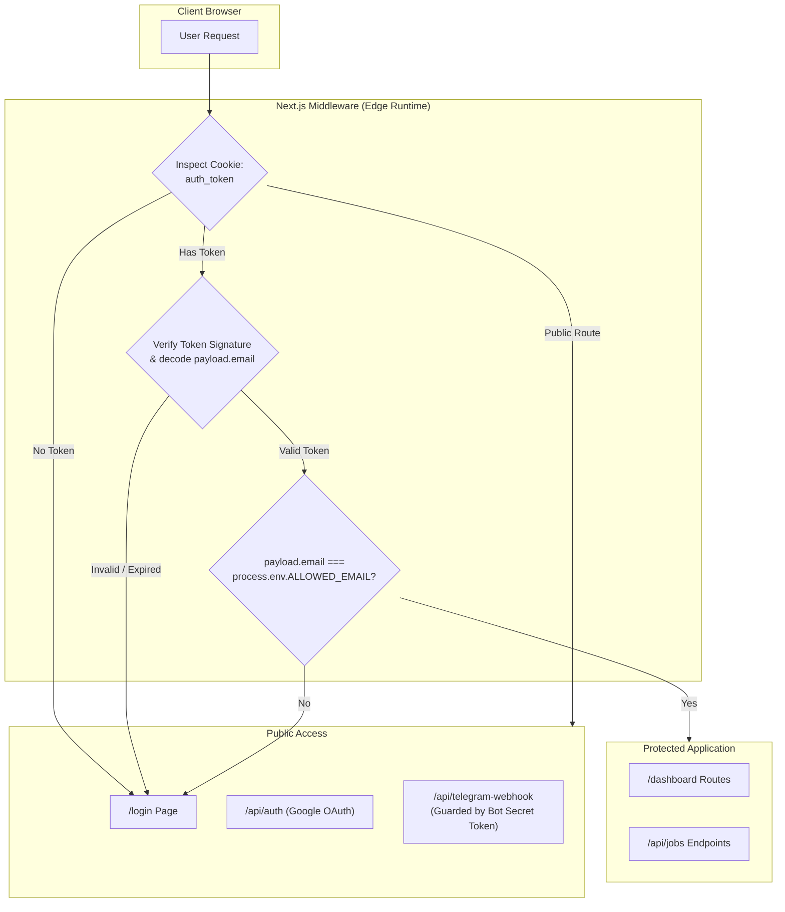

# System Design & Architecture Document: Personal Job Search & Tracking Board

## 1. System Overview & Engineering Objectives

The **Personal Job Search & Tracking Board** is a high-efficiency personal application built on **Next.js (TypeScript)**, **Neon PostgreSQL (Serverless)**, and **Pluggable LLMs (DeepSeek / OpenAI)**.

### Core Engineering Objectives:

- **Zero-Latency Webhook Interception**: Telegram webhooks must acknowledge with `HTTP 200` in `< 500ms`, decoupling ingestion from the heavier scraping and LLM parsing pipelines.
- **Resilient Web Scraping**: Universal handling of static job portals (Lever, Greenhouse, Ashby) and complex client-side rendered Single-Page Applications (SPAs) like **Workday** and LinkedIn.
- **Provider-Agnostic LLM Layer**: Standardized OpenAI-compatible abstraction allowing seamless toggling between **DeepSeek** and **OpenAI (ChatGPT)** with identical prompt schemas.
- **Zero Cold-Start Database Operations**: Serverless PostgreSQL querying using **Drizzle ORM** with connection pooling over WebSockets/HTTP.
- **Single-User Perimeter Security**: Google OAuth with signed JWT session cookies and middleware-level `ALLOWED_EMAIL` gating.

---

## 2. High-Level System Architecture

```mermaid
graph TD
    subgraph Ingestion_Sources["Ingestion Channels"]
        TG["Telegram Channel Post\n(Link only)"]
        BM["Browser Bookmarklet\n(Desktop 1-Click)"]
        MN["Dashboard Manual Entry\n(Modal Form)"]
    end

    subgraph API_Gateway["Next.js Route Handlers (Edge/Serverless)"]
        WH["/api/telegram-webhook\n(Secret Verified)"]
        BM_API["/api/jobs/bookmarklet\n(JWT Verified)"]
        MN_API["/api/jobs/manual\n(JWT Verified)"]
    end

    subgraph Core_Services["Core Application Services"]
        VAL["URL Normalizer &\nDe-duplication Cache"]
        SCRAPE["Universal Scraper Engine\n• Tier 1: Jina Reader Proxy (Workday/SPA)\n• Tier 2: Direct HTTP Fetch"]
        AI["Pluggable AI Extractor\n• DeepSeek API (Default)\n• OpenAI API (Fallback/Switch)"]
    end

    subgraph Data_Storage["Neon DB (PostgreSQL)"]
        DB[("jobs & users tables")]
    end

    subgraph Web_Client["Next.js App Router (React Server/Client)"]
        DASH["Personal Dashboard UI\n• Funnel Analytics Ribbon\n• Timeline Filters & Stale Alerts\n• 1-Click 'Apply & Advance'\n• Personal Notes Drawer\n• CSV Exporter"]
    end

    TG -->|POST update| WH
    BM -->|POST URL| BM_API
    MN -->|POST payload| MN_API

    WH -->|Ack 200 & Async Dispatch| VAL
    BM_API --> VAL
    MN_API --> VAL

    VAL -->|Valid & Unique Link| SCRAPE
    SCRAPE -->|Clean Markdown / Text| AI
    AI -->|{ company, role, link }| DB
    DB -->|Drizzle ORM Queries| DASH
```

---

## 3. Component Deep Dive

### 3.1 Ingestion Layer & Handlers

#### A. Telegram Webhook Handler (`/api/telegram-webhook`)

1. **Secret Validation**: Validates the incoming header `X-Telegram-Bot-Api-Secret-Token` against the local environment variable `TELEGRAM_WEBHOOK_SECRET`. Unsigned requests immediately return `401 Unauthorized`.
2. **Payload Extraction**: Parses `update.channel_post.text` or entities to extract raw URLs using regex:
   ```regex
   https?:\/\/[^\s]+
   ```
3. **Immediate Acknowledgement**: Returns `HTTP 200 OK` instantly to Telegram within `< 200ms` to prevent duplicate webhook delivery retries.
4. **Asynchronous Task Execution**: Dispatches the scraping and parsing workflow in a detached background execution context (Next.js `waitUntil` / serverless background task).

#### B. Browser Bookmarklet (`/api/jobs/bookmarklet`)

- A minimal JavaScript bookmarklet added to the user's browser bookmarks bar:
  ```javascript
  javascript: (function () {
    const url = encodeURIComponent(window.location.href);
    fetch('https://your-domain.vercel.app/api/jobs/bookmarklet?url=' + url, {
      method: 'POST',
      credentials: 'include',
    }).then((r) => alert('Job Sent to Board!'));
  })();
  ```
- Validates the user's JWT session cookie and pushes the URL into the ingestion pipeline.

#### C. Manual Add API (`/api/jobs/manual`)

- Supports two modes:
  - **Quick Fetch**: Takes `{ link }` and runs the scraper + AI pipeline, returning the extracted `{ company, role, link }` for user confirmation before inserting.
  - **Direct Save**: Takes `{ company, role, link }` directly and writes to database immediately.

---

### 3.2 Web Scraping Engine (Universal Portals & Workday)

Applicant Tracking Systems (ATS) present different rendering strategies:

- **Static ATS** (Lever, Greenhouse, Ashby, Workable): Plain HTML contains all job details.
- **Client-Side SPA ATS** (Workday, Taleo, LinkedIn, custom React/Vue company sites): Initial HTML is a bare container; content is populated via client-side AJAX requests.



#### Scraper Implementation Details:

1. **Jina Reader Service**:
   - Prepends `https://r.jina.ai/` to the target URL.
   - Jina executes JavaScript in a headless browser environment, strips CSS/scripts, and returns pure Markdown text.
   - Built-in 8-second timeout.
2. **Direct Fetch**:
   - Standard Node `fetch()` with Chrome desktop headers:
     ```typescript
     headers: {
       'User-Agent': 'Mozilla/5.0 (Macintosh; Intel Mac OS X 10_15_7) AppleWebKit/537.36 (KHTML, like Gecko) Chrome/120.0.0.0 Safari/537.36',
       'Accept': 'text/html,application/xhtml+xml,application/xml;q=0.9,*/*;q=0.8'
     }
     ```
3. **Fail-Safe Mechanism**:
   - If both Tier 1 and Tier 2 fail (e.g. login-walled portals), the system does not crash:
     - Extracts the root domain (e.g., `nvidia.wd5.myworkdayjobs.com` $\rightarrow$ `"Nvidia"`).
     - Saves record with `company: "Nvidia"`, `role: "Review Role (Manual Check)"`, `link: url`.

---

### 3.3 Pluggable AI Extraction Layer

Both DeepSeek and OpenAI support the OpenAI-compatible REST specification (`/chat/completions`).

```mermaid
flowchart LR
    A[Scraped Clean Text] --> B[LLM Factory Adapter]
    B -->|LLM_PROVIDER=deepseek| C[DeepSeek Client\nBase: https://api.deepseek.com\nModel: deepseek-chat]
    B -->|LLM_PROVIDER=openai| D[OpenAI Client\nBase: https://api.openai.com/v1\nModel: gpt-4o-mini]
    C --> E[Strict System Prompt\nJSON Mode Output]
    D --> E
    E --> F[Zod Schema Validation]
    F --> G[Validated Record:\n{ company, role, link }]
```

#### Prompt Specification:

```text
System: You are an expert ATS parser. Extract the hiring company name and the exact role title from the provided job posting text.
Output MUST strictly be valid JSON matching this schema:
{
  "company": string,
  "role": string
}
Do not include markdown fences, comments, or extra keys.
```

#### Schema Validation (Zod):

```typescript
import { z } from 'zod';

export const ExtractedJobSchema = z.object({
  company: z.string().min(1).max(255),
  role: z.string().min(1).max(255),
});
```

---

### 3.4 Database Architecture & Drizzle ORM (Neon PostgreSQL)

Neon provides serverless PostgreSQL with scale-to-zero compute and instant connection pooling over WebSockets.

#### Data Schema:

```sql
-- 1. Users Table (Personal Account)
CREATE TABLE users (
    id UUID PRIMARY KEY DEFAULT gen_random_uuid(),
    email VARCHAR(255) NOT NULL UNIQUE,
    name VARCHAR(255),
    image TEXT,
    created_at TIMESTAMP WITH TIME ZONE DEFAULT CURRENT_TIMESTAMP,
    updated_at TIMESTAMP WITH TIME ZONE DEFAULT CURRENT_TIMESTAMP
);

-- 2. Jobs Table
CREATE TABLE jobs (
    id UUID PRIMARY KEY DEFAULT gen_random_uuid(),
    company VARCHAR(255) NOT NULL,
    role VARCHAR(255) NOT NULL,
    link TEXT NOT NULL UNIQUE,
    location VARCHAR(255) NOT NULL DEFAULT 'N/A',
    exp VARCHAR(100) NOT NULL DEFAULT 'N/A',
    status VARCHAR(50) NOT NULL DEFAULT 'Saved',
    notes TEXT NOT NULL DEFAULT '',
    follow_up_date DATE,
    applied_at TIMESTAMP WITH TIME ZONE,
    source VARCHAR(50) NOT NULL DEFAULT 'telegram', -- 'telegram' | 'manual' | 'bookmarklet'
    created_at TIMESTAMP WITH TIME ZONE DEFAULT CURRENT_TIMESTAMP,
    updated_at TIMESTAMP WITH TIME ZONE DEFAULT CURRENT_TIMESTAMP
);

-- Indexes for Dashboard Performance
CREATE INDEX idx_jobs_status ON jobs(status);
CREATE INDEX idx_jobs_created_at ON jobs(created_at DESC);
CREATE INDEX idx_jobs_applied_at ON jobs(applied_at DESC);
CREATE UNIQUE INDEX idx_jobs_link ON jobs(link);
```

#### Drizzle Schema Definition (`src/db/schema.ts`):

```typescript
import { pgTable, uuid, varchar, text, timestamp, date } from 'drizzle-orm/pg-core';

export const jobs = pgTable('jobs', {
  id: uuid('id').defaultRandom().primaryKey(),
  company: varchar('company', { length: 255 }).notNull(),
  role: varchar('role', { length: 255 }).notNull(),
  link: text('link').notNull().unique(),
  location: varchar('location', { length: 255 }).default('N/A').notNull(),
  exp: varchar('exp', { length: 100 }).default('N/A').notNull(),
  status: varchar('status', { length: 50 }).default('Saved').notNull(),
  notes: text('notes').default('').notNull(),
  followUpDate: date('follow_up_date'),
  appliedAt: timestamp('applied_at', { withTimezone: true }),
  source: varchar('source', { length: 50 }).default('telegram').notNull(),
  createdAt: timestamp('created_at', { withTimezone: true }).defaultNow().notNull(),
  updatedAt: timestamp('updated_at', { withTimezone: true }).defaultNow().notNull(),
});
```

---

## 4. End-to-End Sequence Diagrams

### 4.1 Telegram Ingestion Pipeline



### 4.2 1-Click "Apply & Advance" Workflow



---

## 5. Security & Authentication Architecture



- **Stateless Tokens**: Uses standard signed JWTs containing `{ sub, email, name }` with a 30-day expiration.
- **CSRF & Cookie Protection**: Cookie attributes `HttpOnly; Secure; SameSite=Lax`.
- **Zero Database Hits on Edge Navigation**: The middleware checks JWT signature using `jose` directly in memory at the edge, ensuring sub-10ms route transitions.

---

## 6. Resilience & Edge Cases

| Scenario                            | Risk                                            | Mitigation                                                                                                                                           |
| ----------------------------------- | ----------------------------------------------- | ---------------------------------------------------------------------------------------------------------------------------------------------------- |
| **Workday SPA Rendering**           | Empty HTML returned by standard `fetch()`       | Routed through Jina Reader proxy (`r.jina.ai`) which executes headless JavaScript and returns clean Markdown.                                        |
| **Strict Anti-Bot Walls / CAPTCHA** | Scraper receives HTTP 403 / 503                 | Fail-safe domain extractor pulls company name from host (e.g. `apple.wd3.myworkdayjobs.com` $\rightarrow$ "Apple"), role defaulted to "Review Role". |
| **Telegram Retry Storm**            | Telegram retries webhook if response takes > 3s | Webhook responds with `HTTP 200` immediately before dispatching scraping or AI extraction.                                                           |
| **Duplicate Posts in Telegram**     | Database pollution from duplicate links         | Unique constraint on `link` column + check-before-insert prevents duplicate records.                                                                 |
| **LLM Provider Outage**             | DeepSeek or OpenAI downtime                     | Pluggable design with fallback to alternative provider or manual review flag.                                                                        |

---

## 7. Technology Stack Summary

| Layer              | Technology                                          | Key Advantage                                                                  |
| ------------------ | --------------------------------------------------- | ------------------------------------------------------------------------------ |
| **Framework**      | Next.js 15 (App Router, TypeScript)                 | Unified API route handlers and server/client rendering                         |
| **Database**       | Neon Serverless PostgreSQL                          | Auto-scaling, branchable, zero server maintenance                              |
| **ORM**            | Drizzle ORM                                         | Zero cold-start latency, full TypeScript type safety                           |
| **AI Providers**   | DeepSeek (`deepseek-chat`) & OpenAI (`gpt-4o-mini`) | Cost-efficient, high-precision structured extraction                           |
| **Scraper**        | Jina Reader API + native `fetch`                    | Handles client-rendered SPAs (Workday) without local Puppeteer/Chrome overhead |
| **Authentication** | Google OAuth + JWT (via `jose`)                     | Zero-friction 1-click login restricted to owner's email                        |
| **Styling**        | Modern Vanilla CSS / Tailwind with Dark Mode Tokens | High-performance, clean responsive interface                                   |
