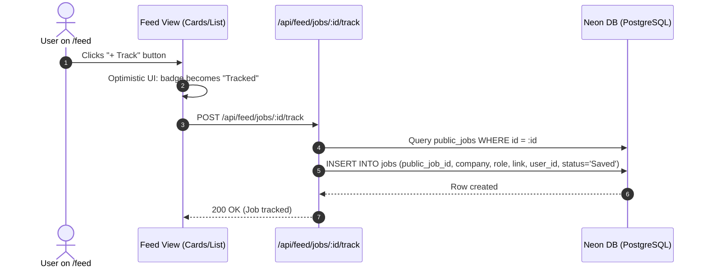
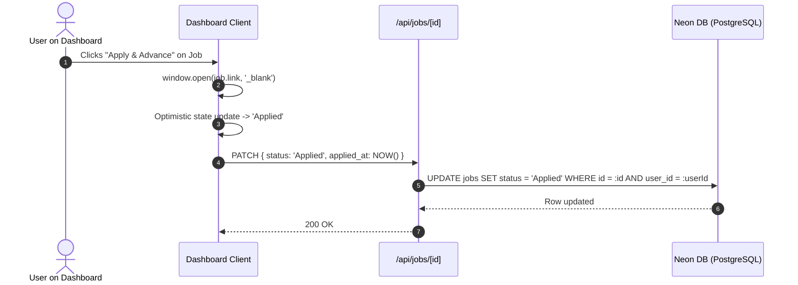

# System Design & Architecture Document: Job Radar Platform

## 1. System Overview & Engineering Objectives

**Job Radar** is a multi-tenant career telemetry and job tracking platform built on **Next.js (TypeScript)**, **Neon PostgreSQL (Serverless)**, and **Pluggable LLMs (DeepSeek / OpenAI)**.

### Core Engineering Objectives:

- **Multi-Tenant Data Isolation**: Complete separation of personal job applications, referral data, and notes scoped by `user_id`.
- **Public Feed & 1-Click Track**: Centralized admin-curated pool (`public_jobs`) with one-click cloning into personal pipelines.
- **Dual Feed View Modes**: Responsive Grid (Cards) view and high-density Table (List) view with pagination.
- **Universal Web Scraping**: Two-tier handling of static ATS (Greenhouse, Lever) and client-rendered SPAs (**Workday**, LinkedIn) via Jina Reader proxy.
- **Pluggable AI Extractor**: Standardized extraction layer toggling between DeepSeek and OpenAI.
- **Open Access Authentication**: Google OAuth and credentials with automatic PostgreSQL account provisioning (`ALLOWED_EMAIL="*"`) and designated platform administration (`ADMIN_EMAIL`).

---

## 2. High-Level System Architecture

```mermaid
graph TD
    subgraph Ingestion_Sources["Ingestion Channels"]
        TG["Telegram Channel Post"]
        BM["Browser Bookmarklet"]
        MN["Dashboard Manual / Auto-Fetch Modal"]
    end

    subgraph API_Gateway["Next.js Route Handlers (Edge/Serverless)"]
        WH["/api/telegram-webhook"]
        JOBS_API["/api/jobs & /api/jobs/[id]"]
        FEED_API["/api/feed/jobs & /track"]
    end

    subgraph Core_Services["Core Application Services"]
        VAL["URL Normalizer & Cache"]
        SCRAPE["Universal Scraper Engine (Jina Reader + Direct Fetch)"]
        AI["Pluggable AI Extractor (DeepSeek / OpenAI)"]
    end

    subgraph Data_Storage["Neon DB (PostgreSQL)"]
        DB[("users, public_jobs, jobs tables")]
    end

    subgraph Web_Client["Next.js App Router Client"]
        DASH["Personal Pipeline (Board & Table)"]
        FEED["Explore Jobs Feed (Grid & List Views)"]
    end

    TG -->|POST update| WH
    BM -->|POST URL| JOBS_API
    MN -->|POST payload| JOBS_API

    WH -->|Valid Link| SCRAPE
    JOBS_API --> SCRAPE
    FEED_API --> SCRAPE

    SCRAPE --> AI
    AI -->|{ company, role, link }| DB

    DB -->|Personal Jobs| DASH
    DB -->|Public Pool| FEED
    FEED -->|1-Click Track| JOBS_API
```

---

## 3. Ingestion & Multi-Tenant Routing

### 3.1 Telegram Webhook Handler (`/api/telegram-webhook`)

1. Validates `X-Telegram-Bot-Api-Secret-Token`.
2. Extracts URL from message text or entities.
3. If `chat_id` matches a user's `telegram_chat_id`, routes directly to their personal board (`jobs`). Otherwise, ingests to the public feed pool (`public_jobs`).
4. Immediately responds with `HTTP 200` to prevent Telegram retry loops.

### 3.2 Public Feed APIs (`/api/feed/jobs`)

- `GET /api/feed/jobs`: Returns public opportunities enriched with `isTracked: boolean` based on the requesting user's personal pipeline.
- `POST /api/feed/jobs`: Admin-only endpoint to post curated opportunities.
- `POST /api/feed/jobs/[id]/track`: Clones a public job into the authenticated user's `jobs` table with initial status `'Saved'`.

### 3.3 Scoped Personal APIs (`/api/jobs`)

- `GET /api/jobs`: Queries only jobs where `user_id = session.sub` (or unassigned fallback for platform admin).
- `POST /api/jobs`: Injects `user_id = session.sub`.
- `PATCH` / `DELETE /api/jobs/[id]`: Enforces `user_id = session.sub` to prevent cross-tenant mutations.

---

## 4. Workflows

### 4.1 1-Click "Track from Feed" Workflow



### 4.2 1-Click "Apply & Advance" Workflow



---

## 5. Security & Authentication Architecture

- **Stateless Tokens**: Signed 30-day JWTs (`jose`) stored in `HttpOnly`, `SameSite=Lax`, `Secure` cookies.
- **Open Access & Roles**: `isAllowedEmail` validates access (`ALLOWED_EMAIL="*"` for open registration). Admin role granted to `ADMIN_EMAIL`.
- **Edge Middleware**: Verifies token signature at the edge in `< 10ms` without database queries on navigation.

---

## 6. Resilience & Edge Cases

| Scenario                  | Risk                                   | Mitigation                                                                        |
| :------------------------ | :------------------------------------- | :-------------------------------------------------------------------------------- |
| **Workday SPA Rendering** | Empty HTML returned by basic fetch     | Jina Reader proxy (`r.jina.ai`) renders JS and returns clean markdown.            |
| **Strict Anti-Bot Walls** | HTTP 403 / 503 from career portal      | Domain extractor pulls company name from host; role set to "Review Role".         |
| **Telegram Retry Storm**  | Telegram retries if webhook takes > 3s | Webhook acknowledges `HTTP 200` immediately before async processing.              |
| **Duplicate Links**       | Multiple entries for same link         | Composite unique indexing `(user_id, link)` prevents duplicate tracking per user. |
| **Provider Downtime**     | DeepSeek or OpenAI outage              | Swappable provider abstraction in `lib/ingestion.ts`.                             |

---

## 7. Technology Stack Summary

| Layer         | Technology                         | Key Role                                                    |
| :------------ | :--------------------------------- | :---------------------------------------------------------- |
| **Framework** | Next.js 16 (App Router, Turbopack) | Server actions, route handlers, dual-mode client rendering  |
| **Database**  | Neon Serverless PostgreSQL         | Serverless pooling, branchable, zero cold-starts            |
| **ORM**       | Drizzle ORM                        | Type-safe queries and schema migrations via Drizzle Kit     |
| **AI Layer**  | DeepSeek-V3 / OpenAI GPT-4o-mini   | High-precision structured metadata extraction               |
| **Scraper**   | Jina Reader API + native fetch     | Headless rendering of SPAs without local browser overhead   |
| **Auth**      | Google OAuth + Jose JWT            | Stateless, secure, cookie-based sessions with open access   |
| **Styling**   | TailwindCSS 4                      | Obsidian design tokens, dual dark/light themes, zero-radius |
